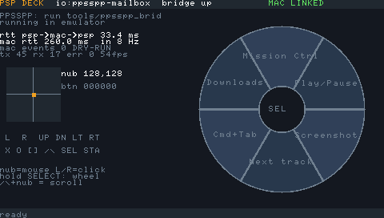
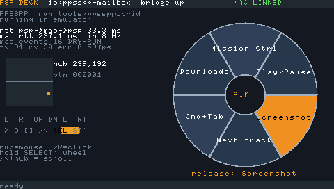
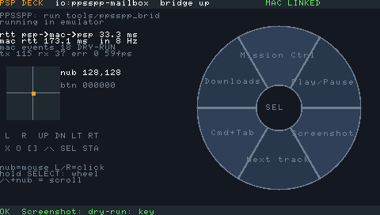
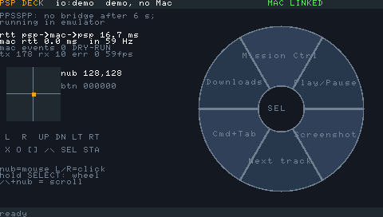

# PSP control deck (track A, `feat/mac-controller`)

This turns the PSP E1000 into a Mac control deck over USB:

- the analog nub moves the mouse
- **L/R** are left/right click (hold **L** and move to drag)
- the D-pad and face buttons send keys
- **△** + nub scrolls
- **START** is play/pause
- hold **SELECT** to open a radial **action wheel**: aim with the nub, release to fire a macro such as
  Mission Control, play/pause, Cmd+Shift+3 screenshot or a shell command

The bindings and wheel macros live in `controller/mac/deck.toml`. The Mac sends the wheel labels to
the PSP when they connect.

| PPSSPP, linked to the real Mac daemon | wheel open, aiming at "Screenshot" | after release: result from the Mac |
|---|---|---|
|  |  |  |

Demo mode is used when no Mac is connected (in PPSSPP without the bridge, or with **△** held at start). Its labels come from the built-in fake Mac: 

## Layout

```
controller/proto_controller.h      message types 0x10-0x15 (C); Python mirror controller/mac/deck/proto.py
controller/psp/                     PSP app -> EBOOT.PBP (+ usbhostfs.prx, pspmaclink.prx)
  main.c        input loop (60 Hz, vblank), wheel state machine, UI (software-rendered, debug font)
  deck_io.c     THE place that picks the transport: USB HOSTFS | PPSSPP mailbox | demo peer
  demo_peer.c   in-process fake Mac over an in-memory pipe (UI works without a Mac)
  usb_stub.c    only for `make USB=0` (emulator-only build)
controller/mac/psp_deck.py          daemon CLI
controller/mac/deck.toml            bindings + wheel (TOML, stdlib tomllib)
controller/mac/deck/                config.py, keys.py (kVK codes from the SDK), mapper.py (pure logic),
                                    backend.py (DryRunBackend | QuartzBackend), daemon.py (session)
controller/tests/                   pytest: protocol vs C header, config, mapper, Quartz event building,
                                    mock end-to-end, HOSTFS session quirks, PPSSPP end-to-end
controller/tools/emu_demo.py        drives the app in PPSSPP and takes the docs/img screenshots
tools/fake_psp_controller.py        fake_psp plugin: scripted nub/buttons/wheel run
HARDWARE_TEST.md                    15-minute real-PSP checklist
docs/DECISIONS-mac-controller.md    decisions taken overnight
```

## Commands

```bash
source tools/env.sh
PY=/Users/semyon/pet_projects/psp_e1000/.venv/bin/python

make -C controller/psp                      # EBOOT.PBP + usbhostfs.prx + pspmaclink.prx (USB=0: emulator-only)
$PY -m pytest controller/tests -q           # 68 tests, ~25 s (the PPSSPP test is skipped if PPSSPP/pspdev are missing)

# mock PSP (scripted run), daemon in dry-run printing the events it would post
$PY tools/fake_psp.py --plugin tools/fake_psp_controller.py --once -- --scenario demo &
$PY controller/mac/psp_deck.py --transport mock --dry-run --events-log - --once

# the real PSP app in PPSSPP, bridged to the daemon
$PY tools/ppsspp.py run controller/psp/EBOOT.PBP --port 45671
$PY tools/ppsspp_bridge.py --port 45671 --listen 47181 &
$PY controller/mac/psp_deck.py -t tcp:127.0.0.1:47181 --dry-run --events-log - --no-moves
$PY controller/tools/emu_demo.py --port 45671 --out /tmp/shots     # injects input + screenshots
$PY tools/ppsspp.py quit --port 45671

# real PSP: see HARDWARE_TEST.md
~/pspdev/bin/usbhostfs_pc -v &
$PY controller/mac/psp_deck.py --transport hostfs          # real CGEvents; needs Accessibility
```

Daemon flags:

| Flag | What it does |
|---|---|
| `--dry-run` | never touches the system and never needs Accessibility |
| `--events-log FILE\|-` | JSON lines of what would be posted |
| `--summary FILE` | rates, RTT and wheel results as JSON at exit |
| `--duration`, `--once` | used by the tests |
| `--check-config` | validate the config and exit |

## Protocol (track range 0x10-0x3F, on top of `common/protocol/psp_link.h`)

| Type | Dir | Payload (LE, fixed size) | When |
|---|---|---|---|
| 0x10 INPUT_STATE | PSP→Mac | u32 buttons, u8 lx, u8 ly, u8 flags (bit0 wheel open), u8 hover, u32 t_us, u32 frame (16 B) | every vblank (60 Hz) |
| 0x11 WHEEL_CONFIG | Mac→PSP | u8 count, u8 ver, u16 0, 8×24 B labels (196 B; frame 208 B, well under usbhostfs's 4 KiB Mac→PSP ring) | after HELLO/HELLO_ACK and on CONFIG_REQ |
| 0x12 WHEEL_FIRE | PSP→Mac | u8 slice, 3×0, u32 t_us (8 B) | SELECT released over a slice |
| 0x13 ACTION_RESULT | Mac→PSP | u8 slice, u8 ok, u16 0, char[48] (52 B) | after running the macro |
| 0x14 CONFIG_REQ | PSP→Mac | empty | every 1 s until the PSP has labels |
| 0x15 MAC_STATUS | Mac→PSP | u32 rtt_us, u32 events, u16 input_hz, u8 dry_run, u8 ax_trusted, u32 0 (16 B) | every 1 s |

Common PING/PONG measures RTT in both directions. The Mac pings every 1 s, and so does the PSP, with an 8-byte "DPKG" + t_us payload.

The session is robust to the HOSTFS quirks: `usbhostfs_pc` accepts TCP before the PSP is attached, and the PSP app can restart under a live TCP connection. The daemon re-sends HELLO every 1 s until the PSP answers. The PSP sends HELLO + CONFIG_REQ every 1 s until it has labels. If no INPUT_STATE arrives for 0.5 s, held buttons and keys are released, so nothing gets stuck when the cable is pulled.
This is covered by `controller/tests/test_deck_hostfs_session.py`.

## Mapping

- **Nub → cursor** (`mapper.py`):
  1. Normalise 0..255 to −1..1.
  2. Apply a radial deadzone (0.15).
  3. Rescale to 0..1 and apply speed = `max_speed · m^exponent` (1400 pt/s, exponent 2.2).
  4. Integrate over the **PSP timestamp** delta, clamped to 50 ms, with sub-pixel accumulation. USB batching or a slow emulator therefore changes neither the distance nor the "feel".
- **Drag:** while a mouse button is held, the backend posts `kCGEvent*MouseDragged` instead of `MouseMoved`. Double-click sets `kCGMouseEventClickState=2`.
- **Keys:** key down on press, key up on release. The daemon generates its own auto-repeat (400 ms delay, then every 60 ms) with `kCGKeyboardEventAutorepeat=1`. Modifier combos set `CGEventSetFlags`.
- **Wheel actions:**
  - `key:` sends down+up
  - `media:` posts an NSEvent systemDefined event, subtype 8, `NX_KEYTYPE_PLAY` = 16, etc. (constants checked in the SDK)
  - `mission_control` runs `open -a "Mission Control"`
  - `app:` runs `open -a`
  - `shell:` runs `/bin/sh` detached and logs the pid
- **Accessibility:** `AXIsProcessTrustedWithOptions(prompt)` runs at start in real mode. The daemon prints the grant instructions and polls until access is granted. `--dry-run` skips the check entirely.

## Verdict (numbers)

| Quantity | Value | How / status |
|---|---|---|
| Report rate, PSP app | **60 Hz** design (one INPUT_STATE per vblank); 59 fps measured in PPSSPP demo mode | on-screen fps counter, `docs/img/deck_demo_mode.png` |
| Report rate seen by the Mac via PPSSPP bridge | 8 Hz | **emulator artefact.** The debugger bridge slows PPSSPP to ~8 emulated frames per wall second; the PSP's own counter still reads 59 fps in emulated time. Correct movement anyway, because mapping uses PSP timestamps |
| Mac→PSP→Mac RTT, PPSSPP bridge | median ~240 ms, p95 ~270 ms | measured (daemon stats); bridge-limited, matches main's ~200 ms bridge figure |
| Mac→fake PSP→Mac RTT, loopback TCP | median 0.27 ms | measured (`fake_psp` + daemon) |
| Mac-side cost per input frame | 5.4 µs decode+map; ~90 µs to build one CGEvent (posting not measured) | measured microbenchmark on this M-series Mac |
| **End-to-end input latency, real USB** | **estimate 10–25 ms typical, ≤ ~30 ms worst** | ESTIMATE from `docs/research/mac-controller.md` ("Latency estimate"): ≤16.7 ms vblank sampling + USB HS bulk <1 ms + usbhostfs_pc/TCP <1 ms + Python <1 ms. Not measured; HARDWARE_TEST step 7 measures RTT |
| Comparable measured rate (other project) | PSPad HID: 124–125 reports/s | research fact #28 (PSP-3001, CFW 6.61). Raising us to 125 Hz would need a sampling thread decoupled from vblank |

These figures fit a cursor-and-macro deck. They are not good enough for competitive gaming.

**Verified tonight:**
- the PSP app runs in PPSSPP and draws the deck UI and wheel
- the real PSP app drives the real daemon end-to-end in dry-run through the bridge (automated test)
- mock end-to-end, mapping, config and protocol tests pass
- CGEvents are built with the real pyobjc API but intercepted before posting
- the USB build compiles and links

**Not verified:**
- anything on real hardware: USB, CFW PRX loading, real report rate and latency
- real CGEvent posting on screen (needs Accessibility, and nobody was at the Mac)
- media keys on macOS 26
- `open -a "Mission Control"`

## Future option: class-compliant USB HID

This was out of scope tonight. A kernel PRX could make the PSP enumerate as a HID
keyboard/mouse/consumer-control device. Prior art is FuSa GamePad, hnaves hidmouse and muxira/PSPad.
That would need no daemon and no Accessibility grant for basic input. Wheel macros would still need
Mac software, or could be mapped to F13–F19 plus macOS Shortcuts. See `docs/research/mac-controller.md`,
"Optional variant / phase 2".
