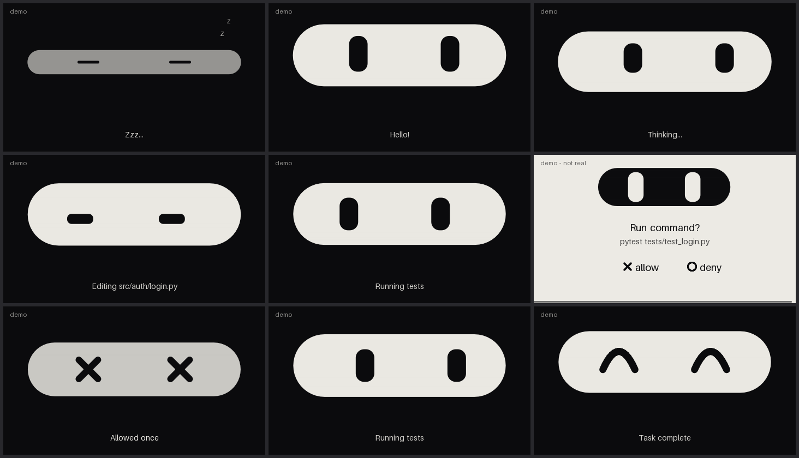

# PSP AI Companion

A pet on a PSP that shows what your Codex agent is doing, over USB. It thinks, edits, runs tests, panics when it needs permission and celebrates when the task is done. You can answer approvals with the X and O buttons.



## Quick start

Once, from the repository:

```bash
export PATH=$HOME/pspdev/bin:$PATH
make -C companion/psp
tools/psp-companion install
```

Copy `companion/psp/EBOOT.PBP`, `pspmaclink.prx` and `usbhostfs.prx` to `ms0:/PSP/GAME/PSPCOMPANION/` on the memory stick.

Then, every time:

1. Connect the PSP to the Mac with USB.
2. Launch **PSP AI Companion** on the PSP.
3. Open Codex Desktop.
4. Type `$psp-connect`.
5. Watch the pet come alive.

In a `workspace-write` session Codex first asks you to approve one escalated command, because the skill has to reach a local socket and the USB port outside the sandbox. Full-access sessions need no prompt.

To try the character without Codex: `psp-companion demo`.

See [What has and has not been verified](#what-has-and-has-not-been-verified) before relying on any of this.

## Features

- A monochrome visor with two cut-out eyes, drawn on the PSP with anti-aliased vector shapes. Only short state messages cross the USB cable, never video.
- Twelve states that ease into each other through the shape of the visor and eyes alone, with blinking, gaze and one-shot reactions. Time-based, so a slow frame costs smoothness and never speed.
- The face runs on its own thread at vblank rate and cannot be stalled by USB.
- One line of status text built from real event data, with long paths and messages truncated.
- When Codex needs a decision the whole screen inverts, with the visor still visible.
- Quick actions and session switching on the physical buttons.
- A deterministic demo mode for filming.

## Architecture

```
 PSP (C)                                      Mac (Python daemon)
 main thread: app.c  pet.c  ui.c  gfx.c       core.py: sessions, approvals, policy (single-threaded)
   |  lock-free rings                           ^        ^              ^             ^
 I/O thread: common/psp/link.c   <--USB-->    psplink.py  appserver.py  rollout.py    ipc.py
             pspmaclink.prx      (or PPSSPP   (pspmac     codex         read session  Unix socket:
                                  mailbox)     transport) app-server    logs          CLI, skill, hooks
```

| Path | What |
|---|---|
| `companion/proto_companion.h` | wire protocol, C side |
| `companion/psp/` | EBOOT: `app.c` UI state machine, `pet.c` character, `ui.c` layout, `gfx.c` rasteriser, `main.c` threads and platform |
| `companion/psp/host/` | the same C code built for macOS: logic tests, frame renderer, protocol vectors |
| `companion/mac/psp_companion/` | daemon: `core.py`, `events.py`, `protocol.py`, `appserver.py`, `rollout.py`, `psplink.py`, `ipc.py`, `demo.py`, `cli.py`, `install.py` |
| `companion/skills/` | `psp-connect` and `psp-disconnect` |
| `companion/tests/` | automated tests and emulator runs |
| `tools/psp-companion` | launcher |

### Protocol

Reuses the existing framed link (`common/protocol/psp_link.h`: magic, sequence number, length, CRC-16) unchanged, over the same transports. Companion messages use types `0xA0`–`0xBF`, and `HELLO.app` is 4. Every payload starts with a version byte. Parsers are bounds-checked and a malformed message is dropped and reported. Every message is under 384 bytes.

| Direction | Messages |
|---|---|
| Mac → PSP | `CONN`, `AGENT`, `ACTIVITY`, `ACTIONS`, `APPROVAL_REQ`, `APPROVAL_CLOSE`, `ACTION_ACK`, `ANIM` |
| PSP → Mac | `BUTTON`, `ACTION`, `APPROVAL_RESP` |
| Both | `HEARTBEAT`; errors use the common `ERROR` frame |

Either side treats 3.5 s of silence as a lost link. The Mac resends the full state after every reconnect and when the PSP's boot id changes.

## Installation details

`tools/psp-companion install` writes three things and is safe to repeat:

| Location | Contents |
|---|---|
| `~/.agents/skills/psp-connect`, `psp-disconnect` | the global skills |
| `~/.local/bin/psp-companion` | symlink to the launcher |
| `~/.psp-companion/config.json` | project path, Python, default transport |

It refuses to overwrite a skill it did not install. If you move or merge the checkout, run it again so the skill points at the right place. `psp-companion uninstall` removes only what it installed.

Mac dependencies are the repository's: Python 3.12 with `requirements.txt` in `.venv`, and `brew install libusb`.

## Building the PSP application

```bash
export PATH=$HOME/pspdev/bin:$PATH
make -C companion/psp          # USB + emulator
make -C companion/psp USB=0    # emulator only
```

`companion/psp/font_data.h` is generated by `companion/tools/gen_font.py` and committed, so building needs no Python. The font is Aileron Regular (CC0).

## Running the daemon

Nothing needs to be started by hand: `$psp-connect` and `psp-companion demo` start it when needed. The daemon holds a file lock, so only one can ever run.

```bash
psp-companion status
psp-companion logs
psp-companion stop
```

| Setting | Default | Meaning |
|---|---|---|
| `--transport`, `PSP_COMPANION_TRANSPORT`, config `transport` | `usb` | `usb`, `mock` (PPSSPP bridge), `tcp:HOST:PORT` |
| `PSP_COMPANION_HOME` | `~/.psp-companion` | state directory; keep the path short, AF_UNIX allows 104 bytes |
| `PSP_COMPANION_CODEX` | `codex` on PATH, then the Desktop's bundled CLI | Codex binary |

Logs are JSON lines in `~/.psp-companion/daemon.log`, rotated at 1 MiB.

### Local security

The state directory is `0700` and the socket `0600`, and every connection's UID is checked with `LOCAL_PEERCRED`. Other users cannot connect. Processes running as you can use the socket, and there are two limits on what that gives them:

- **The socket has no operation that decides an approval.** Only an `APPROVAL_RESP` from the PSP can, which takes a physical press.
- It can send a prompt to a companion-managed session, which any process running as you could equally do by running `codex` itself.

Nothing listens on the network.

## Connecting a Codex session

| Command | Effect |
|---|---|
| `$psp-connect` in Codex | attach this session |
| `psp-companion connect --thread <id>` | attach a session by id, from a terminal |
| `psp-companion connect --latest-in-cwd` | attach the newest session started in this folder (explicit opt-in) |
| `psp-companion start --cwd DIR` | start a companion-managed session with full control |
| `psp-companion prompt "text"` | send a prompt to a managed session |
| `psp-companion select <id>` | show another attached session |

The session is identified from `CODEX_THREAD_ID`, which Codex sets for commands it runs. The daemon checks that a session log exists for that id and that the log's own header carries the same id. If the id is unavailable, the command lists candidates and attaches nothing; it never guesses.

Attaching is idempotent. Repeating `$psp-connect` reports "Already attached".

### Disconnecting

`$psp-disconnect` in Codex, or `psp-companion disconnect --thread <id>`, or `--all`. Detaching only stops the display. It does not touch the Codex session.

## Supported Codex modes

| | Desktop session, default | Desktop session + hooks | Managed App Server session |
|---|---|---|---|
| Set up by | `$psp-connect` | plus `psp-companion hooks install`, then trust them once | `psp-companion start` |
| Mechanism | read-only following of the session log | official Codex hooks | official `codex app-server` over stdio |
| Turn start and end | yes | yes | yes |
| Commands and edits | after they finish | live | live |
| Approvals on the PSP | no, approve in Codex | yes | yes |
| Quick actions | no, disabled with a reason | no, disabled with a reason | yes |
| Changes to your Codex config | none | adds `~/.codex/hooks.json` | none |

**Session logs are not a documented API.** The record format could change in a Codex update. Unknown records are ignored and nothing is ever written, so the worst case is a less informative pet.

**Hooks are optional and off by default.** The installer never adds them. `psp-companion hooks install` merges with any existing `~/.codex/hooks.json`, keeps a backup, and `hooks uninstall` removes only its own entries. Codex skips a new hook until you review and trust it in Settings > Hooks; the companion does not touch that step. For sessions that are not attached the hook exits at once with no output, which Codex treats as no opinion.

**Managed sessions** default to `on-request` with `workspace-write`. The daemon refuses `never` and `danger-full-access`.

## PSP controls

| Button | Normal | Quick-action menu | Approval showing |
|---|---|---|---|
| D-pad up / down | select action, shown in the status line | move selection | |
| X | run the selected action, only while it is shown | run | **Allow** |
| O | dismiss | close | **Deny** |
| START | open the menu | close the menu | |
| SELECT | diagnostics | diagnostics | diagnostics |
| L / R | previous / next session | | |

Quick actions, all of which run in the connected session's project through Codex:

1. Continue task
2. Summarize progress
3. Run project tests
4. Inspect recent errors
5. Interrupt task (asks for a second X)

A disabled action shows why and sends nothing. The status line reports what Codex actually did: "started" when the turn begins and "done" or "failed" when it ends. Delivery over USB is never reported as success.

### Approval rules

- X means allow **once**. Session-wide grants and policy changes are never sent.
- X and O are ignored for 450 ms after the overlay appears, and until both have been released, so a press already in progress cannot answer it.
- The decision must carry the request id currently on screen, for the session on screen, in the turn still running, before the deadline. Ids are random and never reused between connections.
- Each request can be answered once. The overlay stays until the Mac confirms what happened.
- A timeout (120 s) or lost link never allows. Managed sessions get a decline. Hooks return no decision, so Codex shows its normal prompt.
- Approvals for a session that is not on screen cannot be answered until you switch to it.
- Requests the PSP cannot represent, such as questions to the user, are rejected with an error.

## Demo mode

```bash
psp-companion demo
```

Runs a scripted story of about 40 seconds, plus your answer, through the real event pipeline, protocol and renderer: sleep, connect, wake, task, thinking, editing, tests, approval, your X or O, reaction, failure, fix, pass, celebration, idle. No answer within 45 s counts as deny.

The demo cannot affect real work. It runs as its own session, its approvals resolve only inside the demo, and it has no path to Codex. The PSP shows "demo" in the corner and "demo - not real" on the approval. It refuses to start while a real session is attached, and attaching one ends it.

`--speed 2` runs faster. Without hardware, run it against PPSSPP:

```bash
.venv/bin/python companion/tests/ppsspp_demo.py /tmp/shots
```

## Troubleshooting USB

Press SELECT on the PSP for diagnostics: frame rate, frame time, transport, link state, frame and CRC counters.

| Symptom | Check |
|---|---|
| PSP says "USB failed ..." | `pspmaclink.prx` and `usbhostfs.prx` must sit next to `EBOOT.PBP`. The error code is the `sce*` result, see `docs/HARDWARE_TEST.md` |
| `waiting for PSP on USB` | App running, cable connected, `system_profiler SPUSBDataType` should list `054C:01CB` |
| `pyusb is not installed` or libusb errors | `.venv` set up, `brew install libusb` |
| `PSP is running another app` | Another EBOOT from this repository is open |
| A USB error about access or claiming | Another process holds the PSP, for example `psp_screen` or a second tool |
| Link drops repeatedly | Try another cable or port. Hub use worked in earlier tests, but a direct port rules it out |
| Pet does not react to a session | `psp-companion status`, then `psp-companion logs` |
| Skill exits with status 75 | Sandboxed session. Approve the escalated command when Codex asks |

## Tests

```bash
make -C companion/psp/host check
.venv/bin/python -m pytest -q companion/tests
make -C common/psp/test && .venv/bin/python -m pytest -q common/python/tests
```

From a git worktree, use the main checkout's `.venv` by absolute path.

Two further runs need PPSSPP. The second also spends a few small turns of Codex quota:

```bash
.venv/bin/python companion/tests/ppsspp_demo.py /tmp/shots
.venv/bin/python companion/tests/ppsspp_real_codex.py /tmp/real
```

## Hardware validation

Not yet done. With the PSP connected, about ten minutes:

1. Run the [quick start](#quick-start) build and copy the three files. Launch **PSP AI Companion**. A thin line should slowly pulse above "Waiting for Mac...".
2. Run `psp-companion demo`. Press X at the approval. The demo should reach "Demo completed."
3. Press SELECT and record fps and frame ms. The target is at least 30 fps.
4. Pull the USB cable during the demo or a session. The visor should close to a line within about 4 s and keep moving. Replug: `psp-companion status` should say linked, and the session should return.
5. Close and reopen the PSP app while a session is attached: the state should return.
6. In Codex Desktop, type `$psp-connect`. The output should say the PSP is linked and name this session. Give Codex a small task and watch the pet.
7. Optional, for approvals in Desktop sessions: run `psp-companion hooks install`, trust the hooks in Settings > Hooks, start a new turn that needs approval and answer it on the PSP. `psp-companion status --json` should show `"hooks_active": true`.

## What has and has not been verified

Tested 2026-11-09 with Codex CLI 0.167.0-alpha.3.2 and PPSSPP 1.20.4.

| Item | Status |
|---|---|
| EBOOT and PRXs build | verified |
| C logic under ASan/UBSan, including 400k fuzzed messages | verified |
| C and Python protocol agree in both directions | verified against the real C code |
| Daemon, CLI, hook script: single instance, reconnect, approval validation, demo | verified with a real daemon process and a fake PSP |
| Real EBOOT ↔ real daemon: demo, buttons, link loss, relink, animation with no link | verified in PPSSPP through the bridge |
| Real Codex session events driving the pet | verified: real `codex exec` session, attached by thread id |
| Real App Server approvals: X ran the command, O did not | verified in PPSSPP with emulated buttons |
| Real quick actions and interrupt | verified in PPSSPP with emulated buttons |
| `$psp-connect` reports the sandbox block; `CODEX_THREAD_ID` matches the session | verified with real Codex in `workspace-write` |
| **Real PSP over USB** | **not tested: no PSP was connected.** The transport itself was proven on this PSP earlier (see `docs/MORNING_REPORT.md`), but this app was not |
| **Frame rate on real hardware** | **not measured.** Emulator frame time is about 3 ms by instruction count, which is only a rough guide |
| **`$psp-connect` attaching from inside an unsandboxed session, or from the Desktop UI** | **not demonstrated.** The Desktop runs the same Codex binary, but this is untested |
| **Hooks with real Codex** | **not demonstrated: requires your trust step.** Tested by feeding the documented payloads to the real hook script |

## Known limitations

- The default Desktop mode sees commands and edits only once they finish, because the session log records items on completion. It cannot see pending approvals. Hooks fix both.
- Quick actions need a managed session. Desktop sessions show them disabled.
- A managed session has no chat window of its own. Use `psp-companion prompt`, or the quick actions.
- Questions Codex asks through `request_user_input` cannot be answered on the PSP; in a managed session the request is rejected.
- The PSP font is ASCII. Cyrillic is transliterated and other scripts become `?`.
- The PSP can display one session at a time.
- PPSSPP cannot emulate USB. Emulator runs use the mailbox bridge, which is slower than real USB.
- Session-log following depends on an undocumented format.
