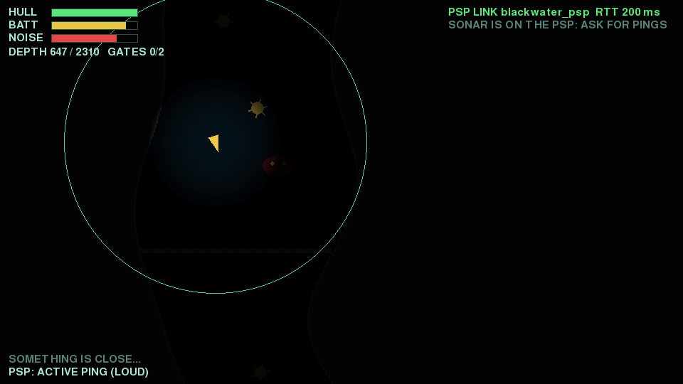
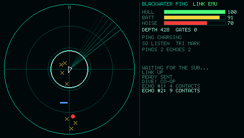
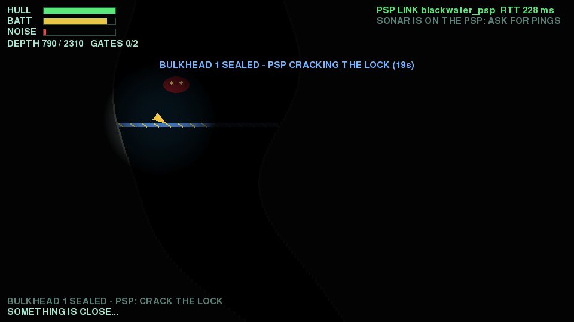
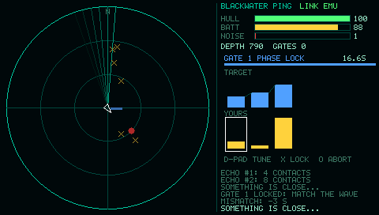

# Blackwater Ping — asymmetric dual-screen game (track C)

Original concept (scout research: `docs/research/dual-screen-game.md`). A salvage sub descends a flooded
mine shaft. The **Mac** is the main screen: almost black, only the sub's lamp shows the rock around it.
The **PSP** is the sub's instrument panel: a sonar scope plus a lock-cracking console. Each screen has
information the other lacks. The Mac sees the walls but not the threats. The PSP sees the threats but
not the walls.

| Mac (pygame-ce, `game/mac/blackwater.py`) | PSP (`game/psp/`, EBOOT) |
|---|---|
|  |  |
|  |  |

All screenshots come from one real loop: the Mac game against the EBOOT running in PPSSPP 1.20.4, joined
by `tools/ppsspp_bridge.py` (`tools/play_emulator_game.py`). The Mac shots are headless (SDL dummy driver).

## The loop

1. **Start:** press START on the PSP (or ENTER on the Mac). The Mac sends `GAME_START`.
2. **Explore and ping:** the Mac player steers. The PSP player presses **✕** for an *active ping*,
   which shows mines, the creature, sealed bulkheads and the exit on the scope with range. Every active
   ping is loud: noise goes up and the creature hunts the place where the ping came from. **□** is a
   *passive listen*: it gives only the creature's bearing, with no range, and it is silent. **△** drops a
   buoy on the nearest threat from the last echo. The buoy then stays visible on the Mac map.
3. **Hack:** when the sub touches a sealed bulkhead, the Mac sends `HACK_REQ`. The PSP shows a
   "phase lock": a target waveform of 4–6 bars. Match it with the D-pad (←→ to pick a slot, ↑↓ to set
   it) and lock it in with **✕**. A wrong ✕ costs 3 s. **○** aborts. You have 20 s.
4. **Result affects the Mac game:** if the lock is cracked, `HACK_RESULT ok=1` opens the bulkhead on the
   Mac. If it fails (timeout or abort), a lock alarm goes off: noise is maxed, the creature is alerted to
   the sub, and the Mac retries after 3 s.
5. **Win / lose:** reach the exit beacon at the bottom to win. You lose when the hull reaches 0 (rock
   scrapes, mines, creature bites) or the battery runs out (5 min, and pings cost charge). The Mac sends
   `EVENT WIN/LOSE`. START or ENTER dives again.

**Solo mode:** the PSP analog nub also steers the sub (`PILOT`, 20 Hz while deflected). One person can play
with the PSP in hand, glancing at the Mac like a Wii U GamePad.

**Controls.** Mac: arrows/WASD thrust, ENTER dive, F12 screenshot to `docs/img/`, ESC quit, P is a debug
ping. PSP: ✕ ping / lock in, □ listen, △ buoy, D-pad tune, ○ abort, START dive, nub steer, hold SELECT
at boot for the offline demo.

## Protocol (track range 0x70–0x9F; `game/proto_game.h` + mirror `game/mac/bw_proto.py`)

Every message rides the shared frame from `common/protocol/psp_link.h` (12 B overhead, CRC-16). Payloads
are fixed-size little-endian structs. Angles are u16 (0..65535 = 0..360°, clockwise from north = screen
up). Distances are u16 Mac pixels.

| Type | Dir | Name | Payload | Size | Rate |
|---|---|---|---|---|---|
| 0x70 | Mac→PSP | GAME_START | level u8, mode u8, seed u32, max_range u16 | 8 | per dive |
| 0x71 | Mac→PSP | SUB_STATE | tick u16, x i16, y i16, heading u16, speed u8, hull u8, battery u8, noise u8, flags u8, gates_open u8 | 14 | 10 Hz (`--state-hz`) |
| 0x72 | Mac→PSP | ECHO | ping_id u8, mode u8, n u8, pad, n × {bearing u16, range u16, kind u8, strength u8} | 4+6n, n ≤ 24 | per ping |
| 0x73 | Mac→PSP | HACK_REQ | gate_id u8, puzzle u8, difficulty u8, pad, seed u32, time_limit_ds u16 | 10 | per bulkhead touch |
| 0x74 | Mac→PSP | EVENT | code u8 (1 DAMAGE, 2 CREATURE_NEAR, 3 GATE_OPEN, 4 WIN, 5 LOSE, 6 BATTERY_LOW, 7 HACK_FAIL, 8 MARKED), pad, arg u16 | 4 | on event |
| 0x80 | PSP→Mac | PING_CMD | ping_id u8, mode u8 (0 passive, 1 active), bearing u16, width u16 | 6 | on ✕ / □ (cooldown 1.5 s / 0.6 s) |
| 0x81 | PSP→Mac | HACK_RESULT | gate_id u8, ok u8, elapsed_ds u16 | 4 | once per HACK_REQ |
| 0x82 | PSP→Mac | MARK | ping_id u8, index u8 (contact index in that ECHO), tag u8, pad | 4 | on △ |
| 0x83 | PSP→Mac | PILOT | ax i8, ay i8 (+y down), buttons u16 | 4 | 20 Hz while the nub is deflected, plus one zero on release |
| 0x84 | PSP→Mac | READY | want u8, pad, version u16 | 4 | on START (title / game over) |

Common frames are also used. HELLO/HELLO_ACK is sent with app id 3. The Mac sends a PING every 1 s,
which the PSP answers with an automatic PONG; this gives the RTT shown on the Mac HUD. The Mac re-sends
HELLO every 1 s while the PSP is silent. The PSP sends HELLO every 1 s until it hears the Mac, and marks
the link lost after 2.5 s without frames.

Rules:
- The Mac owns the world. The PSP never sends positions.
- `MARK` names a contact by (ping_id, index), so the Mac places the buoy exactly where that contact was.
- The lock solution is derived on the PSP from the seed (xorshift32, `bw_rng_next`, mirrored in Python).
  The Mac trusts `ok`.
- A `READY` during a dive re-sends `GAME_START`, so a restarted PSP app rejoins the dive.

## Code map

| Path | What |
|---|---|
| `game/proto_game.h` | message ids, sizes, pack/unpack (plain C) |
| `game/psp/console.c` | PSP game logic: phases, sonar contacts in world coordinates, pings/cooldowns, buoy pick, phase-lock puzzle, nub→PILOT |
| `game/psp/view.c`, `gfx.c` | software renderer into the 8888 framebuffer (own 5×7 font with a slashed zero, lines, circles) |
| `game/psp/app.c` | glue: `psp_link_t` over any io + console + HELLO/link-timeout logic |
| `game/psp/main.c` | PSP platform. `select_io()` is the only place that picks the transport: USB hostfs on hardware, the mailbox in PPSSPP, or the in-process demo Mac (`demo_mac.c`) as fallback or when SELECT is held |
| `game/psp/host/` | macOS build of the same C code: unit tests, plus `psp_host` (TCP "PSP" with a bot, PPM screenshots, `--hackgen` golden) |
| `game/mac/world.py` | authoritative simulation (no pygame), plus a cheating autopilot for tests |
| `game/mac/blackwater.py` | pygame-ce renderer, link manager (background reconnect, liveness), CLI, JSON summary |
| `tools/fake_psp_game.py` | `fake_psp.py` plugin: scripted Python console (pings, listens, buoys, solves or fails locks) |
| `tools/play_emulator_game.py` | full loop with the EBOOT in PPSSPP. Presses PSP buttons over the debugger and saves both screens. |

## Build and test

```bash
source tools/env.sh
make -C game/psp                       # EBOOT.PBP + usbhostfs.prx + pspmaclink.prx (USB on by default; USB=0 to drop it)
make -C game/psp/host                  # C unit tests (ASan/UBSan) of the PSP logic on macOS
.venv/bin/python -m pytest -q game/tests          # proto mirror, world rules, e2e vs fake_psp and vs psp_host
BW_EMU=1 .venv/bin/python -m pytest -q game/tests -k ppsspp   # + full loop vs the EBOOT in PPSSPP (~2 min)
```

Manual play (mock): `python tools/fake_psp.py --app 3 --plugin tools/fake_psp_game.py -- --mark` in one tab
and `python game/mac/blackwater.py` in another. You can also run the real C console in a terminal with
`make -C game/psp/host psp_host && game/psp/host/psp_host --tcp 47100 --bot`.
Emulator: `python tools/play_emulator_game.py` (it builds, launches PPSSPP on port 45673, bridges and plays).
Hardware: see `HARDWARE_TEST.md`.
