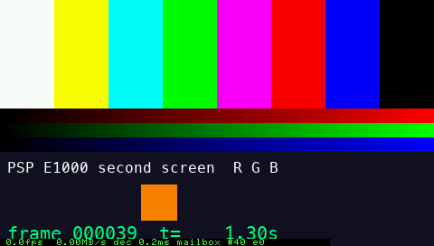
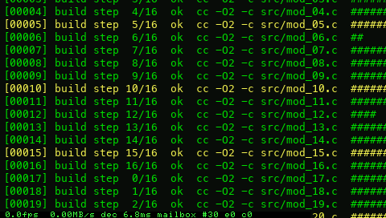

# PSP E1000 as a Mac second screen (feat/second-screen)

The Mac captures (or generates) a 480×272 picture. It encodes it as PSP-order RGB565 16×16 dirty tiles with optional LZ4 and streams it over the shared PSP⇄Mac link (USB bulk on hardware). The PSP decodes it into its 565 framebuffer, shows fps / MB/s / decode ms, and ACKs every frame for flow control.

Hardware steps: [`../HARDWARE_TEST.md`](../HARDWARE_TEST.md). Decisions: [`../docs/DECISIONS-second-screen.md`](../docs/DECISIONS-second-screen.md).

| | Status (2026-11-07, no PSP attached) |
|---|---|
| PSP EBOOT build (`make -C screen/psp`, USB included) | **verified** (pspdev psp-gcc 15.2) |
| PSP app in PPSSPP, recorded stream (replay io) | **verified, pixel-exact** (VRAM compared with the source, rows 0..263) |
| PSP app in PPSSPP, live Mac sender through `tools/ppsspp_bridge.py` | **verified, pixel-exact**. 6–11 fps, bridge-bound (see below) |
| Mac sender ⇄ `fake_psp` (the PSP's C decoder via ctypes) | **verified, pixel-exact** (39 automated tests + 2 opt-in PPSSPP tests) |
| Real USB (`--transport usb`, pspmaclink.prx) | implemented and compiles; **not run** (needs the PSP) |
| HOSTFS fallback (`--transport hostfs`) | implemented with ≤3000 B chunks and per-chunk stop-and-wait, because usbhostfs buffers only 4 KiB and drops overflow. Tested against the fake PSP; **very slow by design, not run on hardware** |
| Sender reconnect after PSP restart / unplug | implemented, tested against the fake PSP (`--reconnect 30`) |
| Real screen/window capture (ScreenCaptureKit, mss fallback) | implemented; CGImage→565 conversion tested; **capture itself not run** (no Screen Recording permission tonight) |
| CGVirtualDisplay (DeskPad-style virtual monitor) | not attempted (stretch) |




## Layout

```
screen/proto_screen.h        message types 0x40-0x6F (C); mac/proto_screen.py mirrors it (sync test)
screen/codec/scr_codec.[ch]  PSP decoder: tiles, solid tiles, LZ4 block, present. Plain C99, no malloc
screen/codec/Makefile        host build: C unit tests (ASan/UBSan, fuzz) + libscrcodec.dylib
screen/psp/                  PSP app (EBOOT): io selection, decode, overlay, ACK, probe sink
screen/mac/psp_screen.py     Mac sender: send | probe | bench
screen/mac/screencodec.py    encoder (numpy) + Python reference decoder
screen/mac/sources.py        test-pattern, image:PATH, video-ish, screen[:X,Y[,W,H]], window:TITLE
screen/mac/capture.py        ScreenCaptureKit (SCScreenshotManager) / mss capture + permission request
screen/tests/                pytest suite, ppsspp_e2e.py, data/desktop.png (synthetic desktop)
tools/fake_psp_screen.py     fake_psp plugin: the PSP's C decoder through ctypes, PNG dumps, probe sink
```

## Commands

```bash
source tools/env.sh                              # pspdev + venv on PATH
make -C screen/psp                               # EBOOT.PBP + pspmaclink.prx + usbhostfs.prx (USB=0: emulator-only)
make -C screen/codec                             # C decoder tests + libscrcodec.dylib
python -m pytest -q screen/tests                 # 39 tests (+2 PPSSPP tests with RUN_PPSSPP=1)
python screen/tests/ppsspp_e2e.py --mode replay  # real EBOOT in PPSSPP, pixel-exact check
python screen/tests/ppsspp_e2e.py --mode mailbox --source test-pattern --frames 40
python screen/mac/psp_screen.py bench --frames 120 --verify

# against the fake PSP
python tools/fake_psp.py --app 2 --plugin tools/fake_psp_screen.py -- --dump-final /tmp/psp.png &
python screen/mac/psp_screen.py --transport mock --source video-ish --fps 30 --duration 5

# real PSP
python screen/mac/psp_screen.py --transport usb --source test-pattern
python screen/mac/psp_screen.py --transport usb --source screen:0,0 --fps 30         # needs Screen Recording
python screen/mac/psp_screen.py probe --transport usb --sizes 16,64,256 --mb 8
```

Sender options: `--fps` (0 = as fast as possible), `--window N` (frames in flight, default 2), `--lz4 off|on|auto` (`on` still falls back to raw when LZ4 does not shrink a chunk, so payloads never exceed 64 KiB), `--max-chunk B` / `--chunk-ack` (automatic for hostfs), `--reconnect S`, `--key-interval S`, `--frames N` / `--duration S`, `--save-last PNG`, `--capture auto|sck|mss`. On the PSP, SELECT toggles the stats line and HOME exits.

## Wire format (inside `psp_link` frames)

`SCR_CHUNK 0x40` (Mac→PSP, ≤ 64 KiB): `frame_id u32, chunk_idx u16, n_items u16, codec u8 (0 raw, 1 LZ4 block), cflags u8 (KEY, LAST), reserved u16, body_len u32`, then the body. The body is a list of records `u16 tag (index | 0x8000 solid)` followed by either `u16 colour` or 256 × `u16` pixels.

`SCR_ACK 0x41` (PSP→Mac, 32 B): frame_id, decode µs, present µs, frames shown, rx bytes, buttons, fps×10, flags (NEED_KEY), decode errors.

Probe: `PROBE_DATA 0x50`, `PROBE_END 0x51`, `PROBE_RESULT 0x52`, `PROBE_RESET 0x53`. Full spec: `proto_screen.h`.

## Codec benchmark (measured on this MacBook, Apple Silicon)

`python screen/mac/psp_screen.py bench --frames 120 --verify` (every frame decoded by the C decoder and checked pixel-exact). Bytes include the 12-byte link framing. The last two columns are **computed, not measured**: min(60, link rate ÷ bytes/frame), ignoring PSP CPU time (see the verdict).

| source | lz4 | frames | avg KiB/frame | max KiB/frame | key KiB | avg dirty tiles | avg encode ms | C decode ms (Mac) | computed link-only fps @8 MB/s | computed @16 MB/s |
|---|---|---|---|---|---|---|---|---|---|---|
| test-pattern | off | 119 | 7.3 | 9.1 | 111.6 | 16 | 0.09 | 0.005 | 60 | 60 |
| test-pattern | auto | 119 | 1.1 | 1.3 | 9.6 | 16 | 0.11 | 0.013 | 60 | 60 |
| static desktop (`data/desktop.png`) | off | 119 | 0.0 | 0.0 | 241.7 | 0 | 0.07 | 0.002 | 60 | 60 |
| static desktop | auto | 119 | 0.0 | 0.0 | 20.0 | 0 | 0.07 | 0.002 | 60 | 60 |
| video-ish (scrolling text, all 509 tiles change) | off | 119 | 255.7 | 256.1 | 254.1 | 509 | 0.58 | 0.034 | 31 | 60 |
| video-ish | auto | 119 | 31.2 | 33.5 | 32.5 | 509 | 0.83 | 0.248 | 60 | 60 |

Unchanged frames send nothing (0 B). Encode time excludes producing the source frame; a real capture adds its own latency (UNVERIFIED).

**PSP-side decode time in PPSSPP** (replay io; overlay "dec" = `scr_dec_chunk` time per frame, *emulated* clock). PPSSPP is not cycle-accurate, so treat these as ESTIMATES of the hardware cost:

| stream | PPSSPP dec ms/frame |
|---|---|
| video-ish raw (509 tiles) | 1.7 |
| video-ish LZ4 | 6.5 |
| test-pattern LZ4 | 0.2 |

**Emulator end-to-end (live sender → bridge → PPSSPP), measured:**
- test-pattern: 10–11 fps, ~1–2 KiB/frame, RTT ~200 ms.
- video-ish: 6.4 fps, 31 KiB/frame = 0.2 MB/s, RTT ~310 ms, window 2.

That is the WebSocket-debugger bridge limit (main measured ~280 KiB/s, ~200 ms RTT), not the design's. 3–4 PPSSPP instances were running at once. The PSP's own fps readout is wrong in mailbox mode because the emulated clock runs slowly while the bridge polls.

**Mac-only loopback (sender → TCP → fake PSP with the C decoder):** video-ish at `--fps 0` ran at 180–290 fps / 5.8–9.4 MB/s. The Mac encoder is not the bottleneck.

## Verdict: expected fps on hardware

Throughput prior art (all from `docs/research/second-screen.md`, not measured by us):
- psp-uvc measured ~16 MB/s PSP→host.
- psp-cast (README, tested on an E-1000 with PRO/LME) makes two separate claims:
  - "~16 MB/s" is the PSP's practical USB limit;
  - its 60 fps 16-bit full-frame mode needs ~15.7 MB/s.
  Both are claimed, not independently measured, and both are PSP→host.
- oasis-os claims 28 MB/s host→PSP (UNVERIFIED).
- pspdisp-linux reports 57–60 fps host→PSP with JPEG.
- We plan with **8 MB/s (conservative)** and **16 MB/s (measured class)**. The real number comes from `psp_screen.py probe` in the morning.

Per-frame time if receive, decode and present run serially:

T = bytes / link + parse+CRC + decode + present

| content | bytes/frame (measured) | link @8 / @16 MB/s | PSP CPU (ESTIMATE) | **fps @8 MB/s** | **fps @16 MB/s** |
|---|---|---|---|---|---|
| full-screen change, raw (`video-ish --lz4 off`) | 261,837 | 32.7 / 16.4 ms | ~12 ms | **~22** | **~35** |
| full-screen change, LZ4 (`video-ish --lz4 auto`) | 31,949 | 4.0 / 2.0 ms | ~16 ms | **~50** | **~55** |
| UI-like, small changes (`test-pattern`) | ~1,150 | 0.1 ms | ~1 ms | 60 (Mac `--fps` bound) | 60 |
| static desktop | 0 (keyframe 20 KiB every 5 s) | – | – | only on change | – |

The PSP CPU column is an ESTIMATE: PPSSPP decode time ×2 for cache and memory stalls (raw 3.4 ms, LZ4 13 ms), plus CRC-16 and parsing at ~25 ns/byte (6.5 ms raw, 0.8 ms LZ4), plus ~2 ms to present. None of it is measured on hardware; the PSP overlay shows the real `dec` ms.

**Bottom line:**
- At the conservative 8 MB/s, raw full-screen updates give **~20–25 fps**.
- With LZ4 `auto`, full-screen scrolling text reaches **~50 fps**, limited by the PSP CPU rather than the link.
- Typical desktop/terminal/dashboard content, where few tiles change, sits at the Mac's capture rate (default 30 fps, `--fps 60` possible).

The open question is Mac capture speed: the SCK one-shot screenshot latency is UNVERIFIED. If it can't hold 30 fps, switch to an `SCStream` delegate. Legibility (a 4.3" 480×272 panel) limits usefulness more than fps: mirror a 480×272 region or one window, not a scaled-down desktop.

## Known issues / next steps

- The USB path has never touched hardware. It depends on main's `pspmaclink.prx`. The first hardware run is `probe`, then `test-pattern`.
- The PSP loop is single-threaded: receive, decode and present are serial. A receive thread and double-buffered present would overlap the link with decoding (worth it only if `probe` shows the link is the limit).
- No vsync on present, so tearing is possible.
- LZ4 `auto` decides by size only. If the PSP's `dec` ms turns out high, `--lz4 off` may win at 16 MB/s+. Compare both in HARDWARE_TEST step 6.
- No JPEG mode (`sceJpegDecodeMJpeg`) for photo/video content. That is the scout's fallback, not built.
- `window:` capture picks the first matching on-screen window and is unverified.
